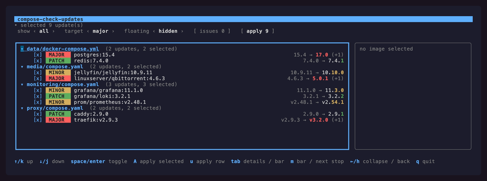
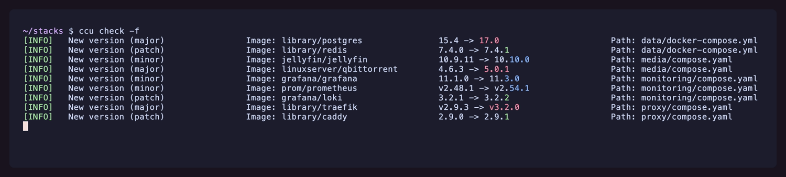
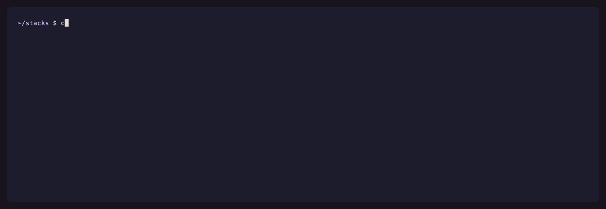

<p align="center">
  
</p>

<h1 align="center">compose-check-updates</h1>

<p align="center">
  Keep your Docker Compose image tags up to date — like <code>npm-check-updates</code>, but for <code>compose.yaml</code>.
</p>

<p align="center">
  <a href="https://github.com/p-arndt/compose-check-updates/actions/workflows/ci.yml"></a>
  <a href="https://github.com/p-arndt/compose-check-updates/releases/latest"></a>
  <a href="LICENSE"></a>
  
</p>

<p align="center">
  <a href="#install">Install</a> ·
  <a href="#quick-start">Quick start</a> ·
  <a href="#features">Features</a> ·
  <a href="#documentation">Docs</a>
</p>

<p align="center">
  
</p>

`ccu` scans every Compose file below a directory, asks each image's registry what
is newer, and rewrites the tags you pick. One static binary — no daemon, no
runtime, nothing to install on the server besides itself.

## Features

- **Interactive or scripted** — a TUI to browse and pick updates, or `ccu check`
  for cron and CI with [meaningful exit codes](docs/cli.md#ccu-check-flags) and
  [JSON Lines output](docs/json.md).
- **You choose the level** — every row offers its patch, minor and major target
  separately, so `traefik:v2.9.3` can go to `v2.11.4` instead of jumping to v3.
- **Writes where the version lives** — the Compose file, the `.env` behind
  `${IMAGE_VERSION}`, or the `FROM` line of a Dockerfile a service builds.
  Every changed file gets a `.ccu` backup.
- **Any OCI registry** — Docker Hub, GHCR, Quay, Harbor, ECR, `registry:2`.
  Private repos work with the credentials `docker login` already stored.
- **More than semver** — date tags, four-segment versions, custom regex schemes,
  commit-tagged and digest-pinned images, and pinning `latest` to a digest.
- **Release notes in the terminal** — read the GitHub or GitLab notes between
  the tag you run and the one you are about to write.
- **Safe defaults** — nothing is written unless you ask, `min_age` holds back
  releases that are only hours old, and per-image caps keep a major from
  slipping in.

## Install

Download the binary for your platform from the
[latest release](https://github.com/p-arndt/compose-check-updates/releases/latest)
and put it on your `PATH`:

```bash
# Linux amd64 — swap the suffix for darwin-arm64, linux-arm64, windows-amd64.exe, …
curl -fsSLO https://github.com/p-arndt/compose-check-updates/releases/latest/download/ccu-linux-amd64
chmod +x ccu-linux-amd64 && sudo mv ccu-linux-amd64 /usr/local/bin/ccu
ccu version
```

Builds exist for linux, macOS and Windows on `amd64`, `arm64`, `arm` and `386`,
each release with a `checksums.txt`. From then on, `ccu self-update` replaces
the binary in place.

## Quick start

`cd` into the directory holding your stacks:

```bash
ccu              # open the TUI: pick rows, press A to apply
ccu check        # print what's outdated (patch updates by default)
ccu check -f     # … at every level
ccu check -f -u  # … and write the new tags
```

In the TUI, `space` selects a row, `→` opens its details to change the target
level, and `A` writes everything selected. Afterwards `ccu` offers to
`docker compose up -d` the affected stacks — it never restarts anything on its
own. [All keys →](docs/tui.md)

<p align="center">
  
</p>

`ccu check` exits `0` when everything is current, `1` when updates are
available and `2` on failure, so a CI gate needs no parsing:

```bash
ccu check -f || echo "images are behind"
```

<details>
<summary><strong>Watch the demo</strong></summary>

<p align="center">
  
</p>

</details>

## Configuration

Neither file is required. `~/.config/ccu/config.yaml` holds preferences for
every project; `.ccu.yaml` in the scan root (or any parent) travels with the
stacks. Flags beat project, project beats global.

```yaml
# .ccu.yaml
exclude: [node_modules, services/legacy]
min_age: 7d              # skip releases younger than a week

images:
  library/traefik:
    max: minor           # never offer a major
  nousresearch/hermes-agent:
    versioning: loose    # tags like v2026.7.7.2
```

`ccu config` prints what was read and from where;
`ccu config -image library/traefik` explains a single image.
[Every key →](docs/configuration.md)

## Documentation

| | |
| --- | --- |
| [Command line](docs/cli.md) | Every command and `ccu check` flag, exit codes |
| [Configuration](docs/configuration.md) | Every config key, per-image settings, `min_age` |
| [Guides](docs/guides.md) | Single images, private registries, the cache, `.env` variables, non-semver tags, digests, floating tags, Dockerfiles |
| [The TUI](docs/tui.md) | Keys, filter vs. target, release notes |
| [JSON output](docs/json.md) | The JSON Lines format, key by key |
| [Troubleshooting](docs/troubleshooting.md) | Missing updates, `x.y` tags, upgrading from v0.6 |

## Contributing

Issues and PRs welcome — registry quirks and real-world Compose files that trip
the parser especially. Plain Go, no codegen; see [CONTRIBUTING.md](CONTRIBUTING.md).

## License

[MIT](LICENSE) © P. Arndt
