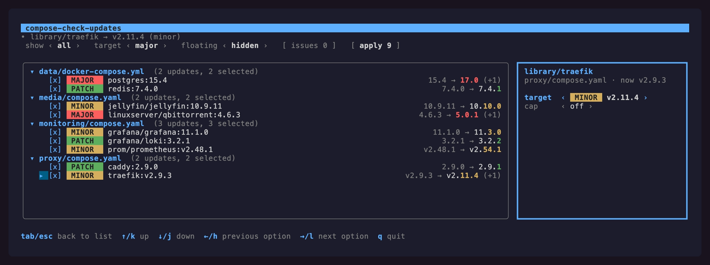

# The TUI

[← README](../README.md) · [CLI](cli.md) · [Configuration](configuration.md) · [Guides](guides.md) · [TUI](tui.md) · [JSON output](json.md) · [Troubleshooting](troubleshooting.md)



Updates grouped per Compose file, streaming in as registries answer.
**Arrows move; `space`/`enter` act on whatever has the focus.** `tab` reaches the
detail column on an image and the settings bar anywhere else. The detail column
also shows how long the target release has been out (`3d ago`). `A` applies, `?`
shows every key.

```
 show ‹ all ›   target ‹ major ›   [ issues 1 ]   [ apply 2 ]
```

You decide per row which version gets written, so a major bump never sneaks in.
Afterwards `ccu` offers to `docker compose up -d` the affected files.

## All keys

| Key | Action |
| --- | ------ |
| `↑`/`↓` or `k`/`j` | Move the cursor. At the top of the list, `↑` carries on into the bar; on the bar, `↓` comes back |
| `pgup`/`pgdn` | Page up / down (`home`/`end` for first / last) |
| `←`/`h`, `→`/`l` | On a header: collapse / expand. On an image: open the details. In the details column: previous / next option. On the bar: previous / next stop |
| `space` / `enter` | Act on what has the focus: select the row, step a setting, press a button |
| `-` | Step the focused setting backwards |
| `z` | Fold/unfold the node under the cursor |
| `C` / `E` | Collapse all / expand all |
| `a` / `n` | Select / deselect everything under the cursor |
| `ctrl+a` / `ctrl+n` | Select / deselect the whole list |
| `f` | Cycle the display filter (which rows are shown) |
| `t` | Cycle the target level for **all** rows |
| `p` | List or hide the floating tags |
| `tab` | On an image: the details column (`tab` or `esc` returns). Otherwise: the top bar |
| `shift+tab` | Step back along the bar |
| `m` | The top bar, from anywhere; again for the next stop |
| `i` | Show the issues logged during the scan |
| `r` | Read the release notes between the current and the target tag (`esc`/`q`/`r` closes) |
| `A` | Apply the **selected** updates |
| `u` | Apply **only the highlighted row** |
| `y` / `n` | Answer the restart prompt |
| `esc` | Back out of whatever has the keyboard (never quits) |
| `?` / `q` | Help / quit |

On a terminal too narrow for two columns the detail column moves *below* the
list rather than disappearing — the per-image target and cap have no keys of
their own.

Where the image says where it is built from and that repository lives on GitHub
or GitLab, `r` shows the release notes of every release between the tag you run
and the one you are about to write, rendered in the terminal. The detail column
counts them (`2 releases · r to read`) and links the release page, cut back to
the releases list when the column is too narrow. Unauthenticated GitHub allows
60 requests an hour; set `GITHUB_TOKEN` or `GH_TOKEN` (`GITLAB_TOKEN` for
GitLab) to lift that. Notes are cached with the registry answers for at least
an hour, and `--refresh` fetches them again.

## Filter vs. target — which version actually gets written

`show` decides which rows are _visible_; `target` decides which version gets
_written_. Both sit on the top bar, both have a key (`f` and `t`); the row's own
target lives in the detail column. The target defaults to `major`, so out of the
box you are offered the highest available version. At `minor`, an image on
`traefik:v2.9.3` with `3.7.8` available re-points to the latest `2.11.x`; at
`patch`, to `2.9.4`.

The sidebar only offers levels an image actually has — `(+2)` after a version
means two other levels exist. A row with nothing at the current target shows as
`[-] … no patch update` and cannot be applied.

An image whose tags ccu could read nothing from shows as `[!] … unreadable · …`
and is never applied. On that row the sidebar grows a **versioning** field:
stepping it to `loose` saves the scheme to your config and re-checks that image
straight away — a repository ccu could not read is fixed where the problem is
shown.

The TUI always resolves **all** levels, regardless of `-patch`, `-minor`,
`-major` or `-f`. Those flags govern `ccu check` only.
